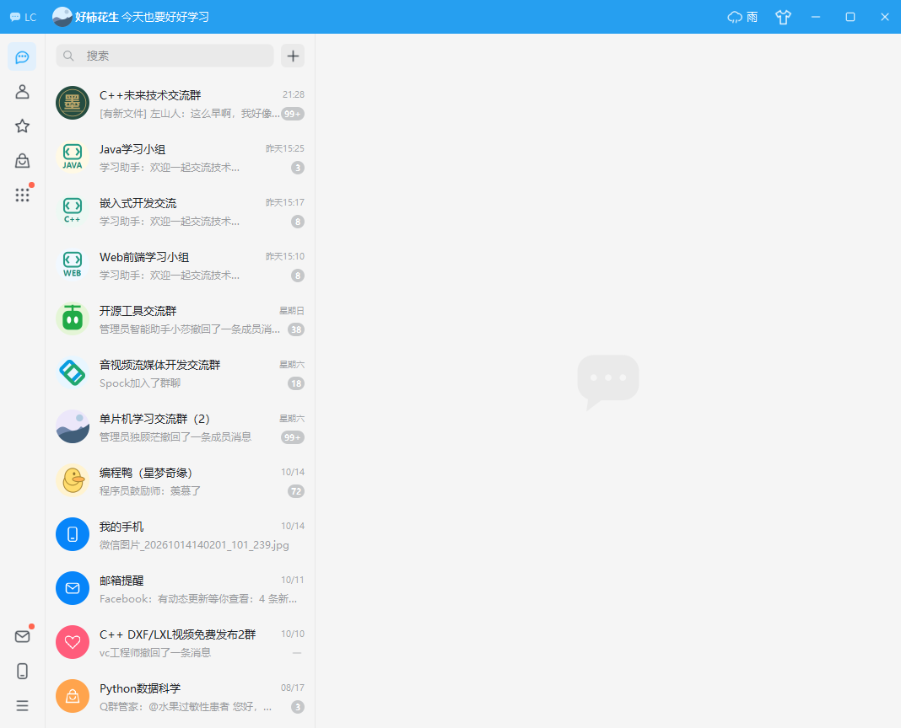
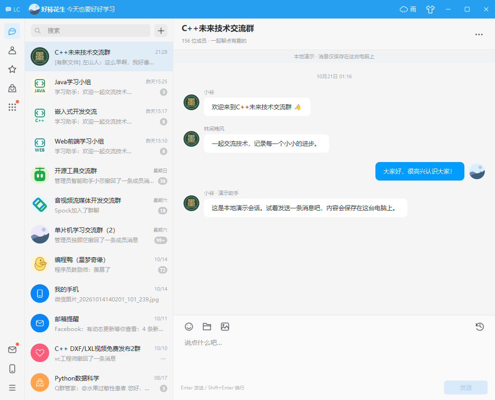

# littlechat · 轻聊

面向 Linux C++ 服务端校招展示的即时通信项目：Windows Qt 6 客户端 + Ubuntu muduo 模块化单体服务端，最高使用 **C++17**。界面借鉴现代聊天软件的通用三栏布局，使用原创聊天标记和 SVG 图形。

**P1 工程整理与 P2 Linux 网络骨架已完成并验证。** 当前可运行 Windows Qt 本地演示和独立 Ubuntu TCP/Protobuf 诊断服务（HELLO、PING/PONG、ECHO）。Qt 尚未连接服务器；真实用户聊天、登录、MySQL/Redis 和 SQLite 缓存仍待后续实现。

开发入口：[当前进度](docs/progress.md) · [总体架构](docs/architecture.md) · [六阶段计划](docs/roadmap.md) · [实际文件树](docs/project-tree.txt)



## 运行

本机已构建的便携版：`build/portable/bin/littlechat.exe`。请保留整个 `portable` 文件夹，里面包含 Qt 运行库和插件；双击即可运行，无需另配 PATH。

这是**本地交互演示**：无需账号，不接入 QQ 或聊天服务器，也不实际上传文件。普通会话会生成明确标注的模拟回复。“我的手机”可作为本地备忘使用。

## 构建

已提供适配本机 `C:\Qt\6.8.3` 的 MinGW 和 MSVC 预设。推荐直接使用已安装的 MinGW 13：

```powershell
cmake --preset mingw-release
cmake --build --preset mingw-release
```

或一条命令构建、测试并部署便携版：

```powershell
.\scripts\build.ps1 -Package
```

部署目录为 `build/portable`，入口是 `bin/littlechat.exe`。手动部署时，`--prefix` 请使用绝对路径：

```powershell
cmake --install build/mingw-release --prefix F:/visualStudio/littlechat/build/portable
```

Visual Studio 2022 / Qt Creator 也可直接打开根目录的 `CMakeLists.txt`。MSVC 使用 `x64-debug` 或 `x64-release` 预设，并选择 MSVC x64 开发环境；不要混用 MinGW 编译器与 MSVC Qt 库。

脚本也支持 `scripts/build.ps1 -Preset x64-release`，会在需要时通过已安装的 VS 工具初始化编译环境。Release 预设明确让 CMake 的编译器探测使用 Release；本机默认 Debug 探测曾返回 C1902，详见进度记录。Debug 预设仍需单独核验。

客户端可以独立配置，不需要安装任何 Linux 服务端依赖：

```powershell
cmake -S client -B build/client-standalone -G Ninja -DCMAKE_BUILD_TYPE=Release -DCMAKE_CXX_COMPILER=C:/Qt/Tools/mingw1310_64/bin/g++.exe -DCMAKE_MAKE_PROGRAM=C:/Qt/Tools/Ninja/ninja.exe -DCMAKE_PREFIX_PATH=C:/Qt/6.8.3/mingw_64
cmake --build build/client-standalone
```

根 CMake 通过 `LITTLECHAT_BUILD_CLIENT`、`LITTLECHAT_BUILD_SERVER`、`LITTLECHAT_BUILD_PROTOCOL` 选择组件；Linux 预设关闭 Qt。Windows 仍明确拒绝配置 Linux 服务端。三个组件均有独立构建入口。

依赖：CMake 3.21+、Qt 6.5+ 的 Widgets / Svg，测试另需 Qt Test。代码在 Qt 6.8.3 + MinGW 13.1.0 下构建验证。

## Linux 网络服务运行

本机已有 WSL 发行版 VSRemote（Ubuntu 24.04.3）。在 PowerShell 输入 `wsl -d VSRemote`，再切换到 `/mnt/f/visualStudio/littlechat`。从仓库根目录执行：

```bash
bash scripts/fetch-linux-deps.sh
cmake --preset linux-debug
cmake --build --preset linux-debug -j 4
ctest --preset linux-debug
./build/linux-debug/bin/littlechat_server --port 9988 --io-threads 2
```

依赖脚本仅获取固定 muduo / GoogleTest 源码到 build/_deps，不安装系统软件。需要已有 C++17、CMake 3.21+、Ninja、Boost 1.83 和精确匹配的 Protobuf 3.21.12；本机已验证。Release 对应 linux-release，内存检查对应 linux-asan。

服务固定监听 127.0.0.1:9988，按 Ctrl+C 退出。它是二进制协议诊断端，尚不能用 Qt 演示客户端登录。查看真实多客户端收发测试：

```bash
./build/linux-debug/server/tst_server_integration ./build/linux-debug/bin/littlechat_server --gtest_filter=NetworkTest.ConcurrentConnectionsReceiveOnlyTheirOwnResponses
```

该测试自行启动服务器并回收子进程；验证 16 个连接各自收发，不代表性能容量。Linux Debug、Release、ASan/UBSan 均通过三组 CTest（协议 10、线程池 8、TCP 10 用例）。完整参数与独立构建见 [服务端说明](server/README.md)，依赖版本见 [dependencies.md](docs/dependencies.md)。

## Windows 11 窗口行为

- 使用不透明的原生 HWND，保留 `WS_CAPTION / WS_THICKFRAME / WS_MAXIMIZEBOX`，通过 `WM_NCCALCSIZE` 移除系统标题栏。
- 自定义最大化按钮的 `WM_NCHITTEST` 返回 `HTMAXBUTTON`；非客户区悬停交给 Windows 处理，提供原生 **Snap Layout** 菜单，而不是自行画一个菜单。
- 支持拖动标题栏、双击最大化 / 还原、八方向缩放、最小化、任务栏工作区约束和系统贴靠。
- `DWMWA_WINDOW_CORNER_PREFERENCE = DWMWCP_ROUND` 提供普通窗口圆角，DWM 绘制系统阴影；没有透明叠层、区域裁剪或假阴影窗口。
- 按 Windows 11 系统规范，最大化或贴靠后使用直角，退出后恢复圆角。Snap 菜单是否显示受系统“贴靠窗口”设置控制。
- 原生命中测试按当前窗口 DPI 换算，支持高分屏及负屏幕坐标。
- 最小尺寸 **360 × 420 DIP**。宽度小于 760 DIP 时，自动切换为会话列表 / 聊天页单面板，用返回按钮切换，适合较窄的分屏区域。

原生行为依据：[微软 Snap Layout 文档](https://learn.microsoft.com/en-us/windows/apps/desktop/modernize/ui/apply-snap-layout-menu)、[DWM 圆角文档](https://learn.microsoft.com/en-us/windows/apps/desktop/modernize/ui/apply-rounded-corners)。

## 交互

- 点击会话打开聊天；搜索匹配会话名和最后一条消息。
- **Enter** 发送、**Shift+Enter** 换行、**Ctrl+K** 搜索、**Esc** 清空搜索 / 返回。
- 右键会话置顶、标记未读、免打扰；星标导航筛选置顶，联系人导航按名称排序。
- 搜索框旁的 **＋** 新建会话；聊天右上角 **…** 修改名称和设置。
- 支持表情、文件名 / 大小记录、消息文本选中复制、草稿、模拟回复、已读状态与三种标题栏配色。
- 文件夹 / 图片按钮仅将所选文件的名称和大小添加到输入框，不复制文件、不发送文件内容。

聊天和草稿通过 `QSaveFile` 原子写入：

```text
%LOCALAPPDATA%/littlechat/littlechat/conversations.json
```

可使用 `--data-file 路径` 指定独立数据文件，方便演示或测试。主题配色仅在当前运行期间有效。



## 测试与截图

```powershell
# 先将 Qt 和 MinGW 的 bin 加入当前终端 PATH，或使用 scripts/build.ps1
$env:PATH = 'C:\Qt\6.8.3\mingw_64\bin;C:\Qt\Tools\mingw1310_64\bin;' + $env:PATH
ctest --preset mingw-release

# 实际 Windows 平台测试（包括 HWND 风格、命中测试、最大化和圆角属性）
.\build\mingw-release\tst_window_win.exe -platform windows

# 单独生成截图，截图后退出；不会写入默认用户数据
.\build\portable\bin\littlechat.exe --data-file build/preview.json --chat 0 --screenshot docs/screenshots/chat.png
.\build\portable\bin\littlechat.exe --data-file build/preview.json --chat 0 --compact --screenshot docs/screenshots/compact.png
```

测试分为 `chatstore`、`mainwindow`、`window_win` 三组，覆盖中文和多行消息持久化、空消息拦截、搜索、草稿切换、发送与延迟回复、未读状态、360 DIP / 480 DIP 布局和 Windows 原生窗口行为。CTest 在 Windows 上自动以原生平台运行窗口测试，也可使用上面的命令单独运行。

## 代码结构

```text
src/
  app/                      应用入口、命令行与截图
  ui/windows/               主窗口与页面交互
  ui/widgets/               标题栏按钮、会话代理、消息气泡
  ui/graphics/              图标渲染、头像绘制和资源注册
  core/models/              消息、会话数据结构
  core/controllers/         消息交互协调（当前仍是本地演示）
  core/storage/             会话操作与 JSON 持久化
  platform/window/          圆角、Snap Layout 与原生窗口行为
resources/
  resources.qrc             Qt 资源清单
  icons/                    SVG 图标
  images/                   图片预留目录
  styles/light.qss          公共界面样式
client/CMakeLists.txt        独立 Qt 客户端构建入口
server/                     muduo 诊断服务、有界任务池与 TCP 集成测试
protocol/                   chat.proto、帧编解码与 GoogleTest
cmake/                      Linux 依赖与 Sanitizer 构建选项
tests/                      数据、界面、Windows 窗口测试
scripts/                    构建部署、固定 Linux 依赖与文件树生成
docs/                       架构、文件树和截图
build/                      构建与便携版产物（不提交 Git）
```

完整目录见 [文件树](docs/project-tree.txt)，职责说明见 [项目架构](docs/architecture.md)。运行 `scripts/update-tree.ps1` 可刷新文件树。新增客户端 C++ 源文件需登记到 `client/CMakeLists.txt`，新增图片、图标和样式资源需登记到 `resources/resources.qrc`。

## 服务端与后续验收

服务端已完成 muduo、Protobuf、连接保护、优雅停服和有界 C++11 线程池基础。P3 继续实现 MySQL 8、Argon2id、连接池、认证、单聊、持久化 ACK、幂等和离线同步，随后通过客户端 Service/Network/Storage 联调。Redis 与性能优化按后续阶段推进。

- [已实现诊断协议与后续 ACK 状态机](docs/protocol.md)
- [数据库与同步事务设计](docs/database.md)
- [依赖与 C++17 兼容性记录](docs/dependencies.md)
- [性能测试方案，当前无压测数据](docs/benchmark.md)
- [面试总结与当前可证明的能力](docs/interview-notes.md)

先前 WSL 的拒绝来自沙箱限制；本轮已通过审批在 VSRemote 实际构建、测试，没有安装或重配 WSL。该发行版已有 MySQL 8.0.46 与本地 socket，但开发头文件/链接库和 Argon2 开发依赖未就绪；尚未连接或修改现有数据库。P3 先准备隔离测试环境与依赖。Docker Linux 引擎仍未用于本项目。
