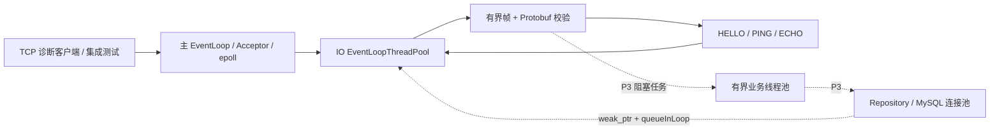

# littlechat 系统架构

P1/P2 已验收。现有实现包含 Windows Qt 本地聊天演示、独立公共协议和 Ubuntu loopback 诊断服务。真正的认证、用户间消息、MySQL 持久化与 Qt 网络接入在 P3/P4；下文明确区分实现和目标。

## 构建边界与目录

| 路径 | 当前职责 |
| --- | --- |
| client/CMakeLists.txt | Qt 客户端独立构建，继续使用根 src/，保留既有代码 |
| src/、resources/、tests/ | Qt UI、Controller、JSON 本地演示、Win32 适配及 Qt Test |
| protocol/ | chat.proto、帧编解码、请求校验、GoogleTest，不依赖 Qt/muduo/数据库 |
| server/src/network/ | muduo TcpServer、连接上下文、诊断分发、限额/超时/停服 |
| server/src/concurrency/ | 有界 std::thread 任务池，准备承载 P3 阻塞业务 |
| server/cmake/、server/patches/ | 固定 muduo 源码与可审计的生命周期补丁 |
| cmake/ | Linux 依赖校验、C++17 与 Sanitizer 构建选项 |
| scripts/ | Windows 构建部署、Linux 依赖获取、文件树生成 |
| docs/ | 设计、阶段验收和实际结果 |
| build/ | 构建、便携版、依赖 checkout、IDE 缓存；Git 忽略 |

根 CMake 可选择 LITTLECHAT_BUILD_CLIENT / SERVER / PROTOCOL。Windows 默认只构建客户端；Linux 预设关闭 Qt。client、server、protocol 均有独立入口。CMake 不静默下载库；Linux 源码依赖由显式脚本获取并检查 commit / 补丁。全项目最高 C++17、关闭语言扩展。

完整目录见 [project-tree.txt](project-tree.txt)，客户端细节见 [client-ui.md](client-ui.md)，实测见 [progress.md](progress.md)。

## 客户端当前与 P4 目标

当前链路是 `MainWindow -> ChatController -> ChatStore(JSON)`。模拟回复明确标注为本地演示；原生窗口、布局、资源和测试保持可用。JSON 同步写只承担小规模本地演示，不充当数据库架构。

目标链路是 `UI -> Controller -> ChatService -> Network / Storage`。Qt Network 异步收发 TCP，复用公共帧模块；SQLite 在独立存储线程处理事务和迁移。网络 QObject 在所属线程使用，以 queued signal/slot 传递拥有自身数据的结果；UI 不调用阻塞 socket 等待，也不做耗时查询。Service 接入后再替换演示入口，保留用户现有数据。

## Linux 网络实现

muduo 实现 one loop per thread，连接固定归属一个 IO loop；io-threads=0 时连接也由主 loop 管理。没有为每个请求新建线程。当前处理都是轻量诊断操作，不将 ECHO 无意义地投递到线程池。默认只监听 127.0.0.1。

网络层限制帧大小、输入/输出积压、连接数量、握手/半包/空闲时间；每轮解析 64 帧后续排任务。具体阈值和瞬时缓冲余量见 [server/README.md](../server/README.md)。这提供基础资源保护；慢读、突发大流量等容量验证仍属 P5/P6。

## 所有权与停服

| 状态 | 规则 |
| --- | --- |
| TcpConnection / Buffer / 连接上下文 | 只在所属 IO EventLoop 读写 |
| 连接注册表 | mutex 下短操作，单调连接 ID → weak_ptr，包含等待清理的拒绝连接 |
| 超时检查 | 主 loop 快照，投递到所属 IO loop，使用 steady_clock |
| 工作任务 | 当前线程池拥有 std::function；P3 将捕获值语义请求/用户 ID/会话代次 |
| 任务异常 | 工作线程捕获；观察者可并发调用，必须自行同步；异常不杀死 worker |
| 数据库租约（P3） | Worker 独占 RAII 连接，不在多个线程共享同步连接 |
| 认证会话（P3） | 用户 ID 与会话代次绑定，回调再次检查，防止旧连接清理新登录 |

线程池队列只限制等待任务，运行任务另计；trySubmit 满时立即返回 Full。Drain 排空，CancelPending 取消等待任务并在锁外释放捕获资源；运行中的任务须自行完成。worker 可以 requestStop，join / waitIdle 必须在 owner 线程；owner 覆盖所有任务生命期。不能通过强杀线程终止事务。

当前停服用 signalfd 接入主 loop。先停止监听，再等待 IO 建连任务屏障；向存量连接 shutdown，1 秒后 forceClose，并有 2 秒补充清理计时。注册表清理排在 muduo 内部 removeConnection 之后，所有连接和屏障完成后退出主 loop。TcpServer 成员先销毁、join IO 线程，其他状态随后销毁，避免回调访问已销毁对象。

muduo v2.0.2 缺少公开停止 acceptor 接口，本项目有唯一受控补丁；调用发生在 pending-functor 阶段，不能在活跃 Channel 回调中随意移除监听器。补丁与回归证据见 [依赖](dependencies.md)、[面试笔记](interview-notes.md)。

## P3 业务目标

后续保持模块化单体：AuthService、SessionRegistry、MessageService、History/SyncService、MySqlPool/Repository、RedisPresenceCache。密码哈希和 SQL 进入有界 Worker，结果通过 weak_ptr / queueInLoop 回到 IO 线程，带请求标识和会话代次核验。

提供至少一次投递与幂等，数据库提交后才发持久化 ACK。唯一约束、事务和持久化同步事件承担可靠性；Redis 只作可退化缓存。客户端本地事务后确认投递，聊天页确认已读，三种状态分别建模。具体仍是 [协议](protocol.md) 与 [数据库](database.md) 中的待实现设计。

## 日志与验证

复用 muduo 日志，当前输出到 stdout，含时间/级别/线程/模块及请求或连接标识，不打印请求正文。滚动与可配置级别未完成。GoogleTest/CTest 覆盖公共协议、线程池、真实多客户端 TCP；Linux Debug/Release 与 ASan/UBSan 已运行，Windows Qt Test 回归通过。未执行 TSan、数据库故障恢复和性能压测，不能据此宣称可靠聊天或高并发指标。
